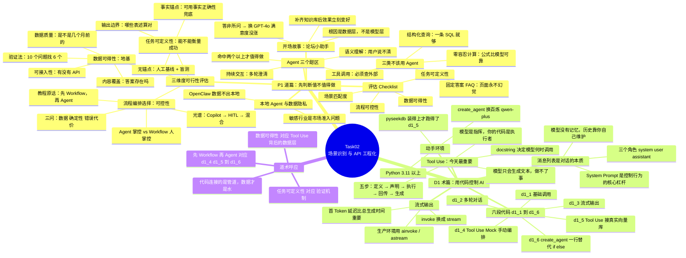

# Easy Data × AI · Task02 思维导图

> 配套笔记：[Task02-场景识别与API工程化.md](Task02-场景识别与API工程化.md)
> 本次任务：Task02 场景识别与 API 工程化（P1 + D1）
> 用途：复盘时先看图，想起主线了再回去翻笔记细节。
> 说明：图里的说法压缩自课程内容，标「教程原话」处引用自课程；不带标记的是我自己的归纳。

## 一、全景图（Mermaid 思维导图）



## 二、纯文本版（Mermaid 渲染不出来时看这个）

```text
Task02 场景识别 与 API 工程化
├── P1 道篇：先判断值不值得做
│   ├── 开场故事：论坛小助手
│   │   ├── 答非所问 → 换 GPT-4o 满意度没涨
│   │   ├── 根因是数据层，不是模型层
│   │   └── 补齐知识库后效果立刻变好
│   ├── 三类不该用 Agent
│   │   ├── 固定答案 FAQ
│   │   ├── 结构化查询（一条 SQL）
│   │   └── 对准确性零容忍的计算
│   ├── 三维度可行性评估
│   │   ├── 数据可得性（地基）
│   │   │   ├── 内容覆盖 / 数据质量 / 可接入性
│   │   │   └── 验证法：10 个典型问题，6 个找不到就先别上 Agent
│   │   ├── 任务可定义性（能不能衡量成功）
│   │   │   ├── 输出形式的边界
│   │   │   ├── 有事实锚点 → 用事实正确性兜底
│   │   │   └── 无事实锚点 → 人工基线 + 盲测对比
│   │   └── 流程编排选择（可控性）
│   │       ├── Agent vs Workflow
│   │       ├── 三问：数据可得性 / 任务确定性 / 错误代价
│   │       ├── 光谱：Copilot → Human-in-the-loop → 混合模式
│   │       └── 教程原话：先 Workflow，再 Agent
│   ├── 评估 Checklist（场景 / 数据 / 任务 / 流程四类）
│   ├── Agent 的三个甜区：语义理解 / 工具调用 / 持续交互
│   └── 本地 Agent 与数据隐私：OpenClaw，敏感行业的市场准入问题
└── D1 术篇：用代码控制 AI
    ├── 对话的本质是消息列表（system / user / assistant，模型没有记忆）
    ├── 流式输出（首 Token 延迟比总生成时间重要）
    ├── Tool Use（五步机制：定义 → 声明 → 执行 → 回传 → 生成）
    ├── 六段代码演进
    │   ├── d1_1 基础调用
    │   ├── d1_2 多轮对话
    │   ├── d1_3 流式输出
    │   ├── d1_4 Tool Use Mock（手动编排）
    │   ├── d1_5 Tool Use + seekdb（真实检索）
    │   └── d1_6 create_agent（一行代码替代 if/else）
    └── 动手环境（Python 3.11+ / pyseekdb / 百炼 qwen-plus）
```

## 三、怎么用这张图

1. **先看 P1 的三维度**：任何「想做个 AI」的需求，按数据可得性 → 任务可定义性 → 流程编排 三格过一遍，过不了就先别立项。
2. **再看 D1 的消息列表**：所有后面看起来复杂的东西（多轮、流式、Tool Use、Agent 循环），底层都是「往列表里追加消息」。
3. **最后看道术呼应**：P1 说数据是地基，D1 里 Tool Use 就是那座桥；桥搭得再好，桥对面没水一样没用。

## 四、参考与引用

- 课程仓库：[datawhalechina/easy-data-x-ai](https://github.com/datawhalechina/easy-data-x-ai)（CC BY-NC-SA 4.0）
- 对应课程稿：`docs/pm/P1 课程稿：AI Agent 场景识别`、`docs/dev/D1 课程稿：大模型 API 工程化基础`
- 本图仅为个人复盘用的结构化摘要，完整表述见配套笔记。
