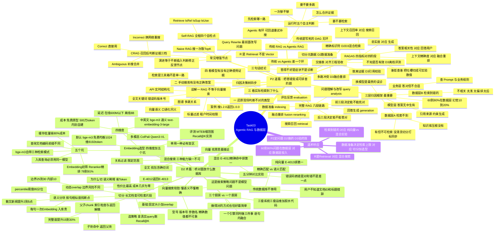

# Easy Data × AI · Task03 思维导图

> 配套笔记：[Task03-AgenticRAG与数据层.md](notes/Task03-AgenticRAG与数据层.md)
> 本次任务：Task03 Agentic RAG 与 AI 应用数据层（P2 + D2）
> 用途：复盘时先看图，想起主线了再回去翻笔记细节。
> 说明：图里的说法压缩自课程内容，标「教程原话」处引用自课程；不带标记的是我自己的归纳。

## 一、全景图（Mermaid 思维导图）



## 二、纯文本版（Mermaid 渲染不出来时看这个）

```text
Task03 Agentic RAG 与 AI 应用数据层
├── P2 道篇：把答错变成可排查的题
│   ├── 三句话结论
│   │   ├── R 是 Retrieval，不是 Vector
│   │   ├── 传统 vs Agentic，差别在有没有环
│   │   └── 「AI 答得不好」是症状，不是诊断
│   ├── 误解一：RAG ≠ 向量搜索（检索是工具箱）
│   │   ├── 全文关键词（错误码 / 版本号）
│   │   ├── 向量语义（口语化 / 同义）
│   │   ├── 标量过滤（租户 / 时间 / 权限）
│   │   ├── 图谱（多跳关系）、API（实时结构化）
│   │   └── 案例：搜 1.2.0 返回 1.0.0 文档
│   ├── 传统 RAG vs Agentic RAG
│   │   ├── 传统：写死的 DAG，无环
│   │   ├── Agentic：有环，可回退 / 重试 / 补搜 / 改路由
│   │   └── 五个自主判断：要不要检索 / 哪一路 / 一次够不够 / 多跳 / 怎么合并
│   ├── 完整 RAG 六段链路
│   │   ├── 数据准备 → 问题理解改写 → 搜索召回
│   │   ├── → 融合重排 → 回答生成 → 评估反馈
│   │   ├── 前三段：能不能找对
│   │   └── 后三段：能不能答对
│   ├── 常见增强节点
│   │   ├── Naive：搜一次取 TopK
│   │   ├── Query Rewrite：最前面改写问题
│   │   ├── CRAG：召回后判证据（Correct / Ambiguous / Incorrect）
│   │   ├── Self-RAG：Retrieve? / IsRel? / IsSup? / IsUse?
│   │   └── 演进 = 不断插入判断 / 修正 / 反馈节点
│   ├── RAGAS 四指标对四阶段
│   │   ├── Context Recall → 召回
│   │   ├── Context Precision → 重排
│   │   ├── Faithfulness → 生成
│   │   ├── Answer Relevancy → 回答
│   │   └── 谁低查谁，把吐槽切成可实验数值
│   ├── 三层归因框架（最重要）
│   │   ├── 数据层 A：检索不到（库里没有 / 有但不可检索）
│   │   ├── 数据层 B：检索到错的（不相关 / 太浅 / 排太后）
│   │   ├── 模型层：幻觉（引用来源 + 约束生成）
│   │   ├── 业务层：答对但不合适（Prompt + 业务规则）
│   │   └── 60%~80% 在数据层，幻觉仅 10%~20%，换模型是最贵的误诊
│   ├── 归因决策树四步：还原现场 → 手动搜库 → 看检索结果 → 看模型是否正确使用
│   └── 交接表：把 PM 判断对齐到 D2/D3 的最小验收证据
└── D2 术篇：桥对面放什么数据库
    ├── 切分：长文档变可检索片段
    │   ├── 基础：固定大小 + overlap
    │   ├── 语义分块：按句相似度断点，95 分位阈值，入库贵，提升 2~5 点
    │   ├── 动态 overlap：边界 25~30%、内部 10%，性价比最高
    │   ├── 父子 chunk：索引粒度与返回解耦，完整度提升 15~30%
    │   └── 选策略：拿 20~50 条真实 query 跑 Recall@K
    ├── Embedding 选型：四维度 + 五个坑
    │   ├── 评测：MTEB 缩范围，Recall@K 实测
    │   ├── 四维度：中英文 / 多模态 / 成本 / 延迟
    │   ├── 默认 bge-m3（免费、中英文均衡、1024 维、8192 token）
    │   └── 五个坑：同模型 / 查询前缀 / 三模式 / Reranker 精排 78→91% / 缓存批量
    ├── 传统数据库不够用：精确匹配 vs 语义匹配
    ├── 向量搜索软肋：懂语义不懂精确（E-4012 返回 E-4013）
    ├── 混合搜索：向量（语义）+ 全文（精确）+ 关系过滤（范围），缺一不可
    ├── 三个厨房 → 一个厨房：复杂度内置到引擎，一条查询做三件事
    └── 五分钟对比实验：纯向量 E-4013 第一，混合 E-4012 第一（对和错）
```

## 三、怎么用这张图

1. **先记住三句话**：R 是 Retrieval 不是 Vector、传统与 Agentic 差一个环、答得不好是症状不是诊断。这三句决定了你看问题的起点对不对。
2. **遇到「AI 答得不好」，直接走归因决策树四步**：先判断类型 → 手动搜库 → 看实际检索到什么 → 看模型有没有正确使用。前三步都在查数据层，别一上来就换模型。
3. **把三层归因框架当检查表**：数据层 A（检索不到）/ B（检索到错的）、模型层（幻觉）、业务层（不合适），心里默念 60%~80% 在数据层这组比例。
4. **需要落地时再翻 D2 术篇**：切分四策略挑一个、Embedding 按四维度选、五个坑逐一核对，最后用「向量 + 全文 + 关系过滤」的混合搜索兜底精确匹配。
5. **最后看道术呼应**：P2 负责「知道该治什么病」，D2 负责「把药做出来」，D3 负责「验药效」——这三篇是一条流水线，跳过任何一步都会退化成「感觉好像好一点」。

## 四、参考与引用

- 课程仓库：[datawhalechina/easy-data-x-ai](https://github.com/datawhalechina/easy-data-x-ai)（CC BY-NC-SA 4.0）
- 对应课程稿：`docs/pm/P2 课程稿：Agentic RAG 产品设计`、`docs/dev/D2 课程稿：AI 应用的数据层`
- 本图仅为个人复盘用的结构化摘要，完整表述见配套笔记 [Task03-AgenticRAG与数据层.md](notes/Task03-AgenticRAG与数据层.md)。
